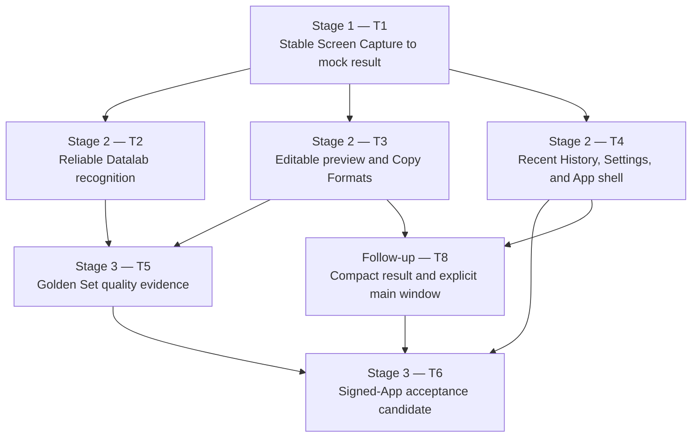

# MyMathpix Personal MVP — Delivery Map

This map presents six original delivery tickets and explicit follow-ups while preserving the engineering coverage from the finer-grained draft as acceptance criteria and suggested work packages.

2026-10-22: Owner accepted Notion and Markdown in the installed App; 07 is resolved.
Lark formula rendering was subsequently accepted as well; 12 is resolved.

2026-10-22: [11 — Duplicate rich table](issues/11-duplicate-rich-table.md) is
resolved. [12 — Lark rich table + math](issues/12-lark-rich-table-markdown-math.md)
is resolved: production clipboard regressions, release build and owner testing
of all three installed-App copy formats passed; the prior App is backed up.

## Execution model

- One main agent owns each ticket's complete user outcome, integration, and acceptance evidence.
- A ticket may use multiple sub-agents for bounded work packages with clean interfaces or sequencing.
- One ticket does not imply one agent, and parallel-capable tickets do not require parallel execution.
- Sub-agent completion is supporting evidence only. The main agent must verify the ticket's end-to-end behavior before resolving it.
- During early stabilization, prefer sequential execution when work packages touch the same capture lifecycle, recognition state machine, or application UI.

## Stages and blocking flow

## Recommended frontier

2026-10-22 — Clipboard follow-ups 07, 11 and 12 are resolved by focused
regressions and owner acceptance of all three installed-App copy formats.
Issue 09 (editing caret jumps to the end) remains open. Ticket 10's permission
verification applies to the earlier frozen 701ac58e artifact; current-release
screen-capture permission has not been independently rechecked. The fourteen-day
Dogfood Gate remains pending. Earlier integration history follows.

## Original V1 acceptance history

Latest disposition2026-10-22: owner accepted V1 and authorized merge to main. Tickets06/08 are resolved on that authority; older menu/QA follow-up descriptions below retain their historical context and do not establish a new physical-menu pass.

1. Ticket `01` is resolved by explicit owner acceptance; its implementation establishes the authoritative capture seam and repairs the reported termination. See [01 — Make Screen Capture survive through a mock result](issues/01-stable-screen-capture.md#answer) for the verified evidence and owner-waived external runs.
2. Tickets `02`, `03`, and `04` are resolved following the owner's confirmations on 2026-10-21; see [Ticket 02](issues/02-reliable-datalab-recognition.md#answer), [Ticket 03](issues/03-edit-preview-copy.md#answer), and [Ticket 04](issues/04-daily-workflow.md#answer). Ticket 04 menu-bar visibility and [Ticket 07 — Notion inline math](issues/07-notion-inline-math.md) remain unresolved follow-ups. These resolutions do not close the final integration gate.
3. Ticket `05` is resolved on 2026-10-22: both modes pass the reviewed ordinary Golden Set at 69/70 with category floors met; boundary failures and original failed baseline remain visible. See [Ticket 05 Answer](issues/05-golden-set-quality.md#answer) and [quality evidence](evidence/ticket05-golden-set/quality-summary.md). This quality evidence remains intact alongside the later owner V1 acceptance.
4. Ticket `08` is resolved by explicit owner acceptance of Personal MVP V1 on2026-10-22. The compact result/main-workspace implementation and QA history remain recorded; unchecked physical-menu/activation and other individual criteria are retained as unverified, not fabricated passes. See [Ticket08 Answer](issues/08-window-roles-regression.md#answer).
5. Ticket `06` is resolved by the same owner V1 acceptance and merge-to-main authority. See [Ticket06 Answer](issues/06-signed-app-acceptance.md#answer) and [exact owner decision](evidence/ticket06-candidate/owner-v1-acceptance.md). Notion07 remains deferred; fourteen-day Dogfood and Public Product are still pending. This explicit owner release decision does not retroactively mark every integration AC passed.
6. On 2026-10-22, the owner reported that every typed character in Edit moves the caret to the end of Combined Output. [Ticket 09 — Preserve the caret](issues/09-result-editor-caret-jumps-to-end.md) records the unverified defect. Investigate after Notion inline math (07), as explicitly requested; no editing repair is included in the clipboard experiment.

2026-10-21: The owner accepted Ticket `04` and requested resolution and merge. Follow-up: the menu-bar icon is still not visible, including after the owner expanded Hidden Bar; its cause and repair remain open. Resolution is an explicit acceptance exception, not a claim that menu-bar visibility passed.

## Delivered context

- Ticket `03` is resolved by owner acceptance on 2026-10-21 for Markdown / Lark / Notion at implementation commit `ec7e140`. See [accepted Lark/three-format verification](evidence/ticket03-lark-copy-2026-10-21.md) and [main integration verification](evidence/ticket03-main-merge-2026-10-21.md). Notion inline math is **not fixed** and is tracked separately in [open Ticket 07](issues/07-notion-inline-math.md). Main integration follows the completed Ticket 04 merge and preserves its shell/window behavior alongside Ticket 02 recognition and Usage Records.

- Earlier Ticket `03` two-action Markdown/Notion candidate was superseded by the accepted three-action workflow above. Its [historical verification](evidence/ticket03-notion-copy-2026-10-21.md) records the original experimental clipboard boundary; it does not establish working Notion inline math.

- Ticket `03` review fixes resolved on 2026-10-21: preserves valid LaTeX row spacing, projects merged cells without TSV column shifts, decodes HTML entities safely, and retains unrelated Complex Table Output. See [verification and review results](evidence/ticket03-spec-fixes-2026-10-21.md). Changes remain on the original Ticket 03 branch.

- Ticket `03` follow-up resolved on 2026-09-06: corrected plain-text table conversion and owner-approved single-line content preview rows, backed by [actual signed-window six-format regression](evidence/ticket03-content-rows/verification.md). This supersedes the earlier format-name-only row design. Integration remains on the original Ticket 03 branch; no other ticket was merged.

- Ticket `03` resolved on 2026-09-05: owner-confirmed compact Result Editor, offline edit/preview, and six immediate Copy Formats. See [Ticket 03 Answer](issues/03-edit-preview-copy.md#answer) and [signed-App UI verification with screenshots](evidence/ticket03-ui/verification.md). Ticket 04 can host `ResultEditorView(item:)` using the selected record and existing `AppModel`; capture-display placement remains Ticket 04 scope. Full-content LaTeX remains undecided.

2026-10-22 final acceptance: owner tested Markdown, Notion and Lark in the
installed d1a143db candidate and accepted all three. Issue 12 is resolved.
Issue 09 (caret position during editing) remains open. GitHub update authorized.

2026-10-23 — [13 — Outside-click dismissal](issues/13-dismiss-compact-result-on-outside-click.md)
is implemented and installed locally (build 5). Signed-window and basic checks
pass. Physical cross-application click acceptance remains pending; no new
GitHub App release has been published.

2026-10-23 final acceptance — Owner accepted the installed outside-click
behavior and requested GitHub publication. Issue 13 is resolved; v0.1.3 carries
this change. Issue 09 remains open. Earlier pending-acceptance notes above are
historical checkpoints.
