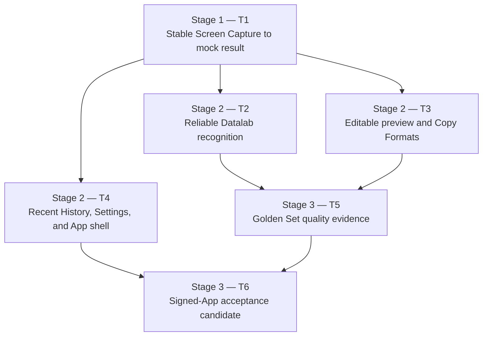

# MyMathpix Personal MVP — Delivery Map

This map presents six user-facing tickets while preserving the engineering coverage from the finer-grained draft as acceptance criteria and suggested work packages.

## Execution model

- One main agent owns each ticket's complete user outcome, integration, and acceptance evidence.
- A ticket may use multiple sub-agents for bounded work packages with clean interfaces or sequencing.
- One ticket does not imply one agent, and parallel-capable tickets do not require parallel execution.
- Sub-agent completion is supporting evidence only. The main agent must verify the ticket's end-to-end behavior before resolving it.
- During early stabilization, prefer sequential execution when work packages touch the same capture lifecycle, recognition state machine, or application UI.

## Stages and blocking flow

## Recommended frontier

1. Ticket `01` is resolved by explicit owner acceptance; its implementation establishes the authoritative capture seam and repairs the reported termination. See [01 — Make Screen Capture survive through a mock result](issues/01-stable-screen-capture.md#answer) for the verified evidence and owner-waived external runs.
2. Tickets `02`, `03`, and `04` are then unblocked. They may run in parallel only when their main agents agree on shared contracts and avoid overlapping edits; otherwise use the easier-to-review order `02 → 03 → 04`.
3. Ticket `05` starts after real recognition and result consumption are complete.
4. Ticket `06` is the integration gate. It must test the assembled signed App and cannot be replaced by reports from earlier tickets.

## Delivered context

- Ticket `03` is resolved by owner acceptance on 2026-10-21 for Markdown / Lark / Notion at implementation commit `ec7e140`. See [accepted Lark/three-format verification](evidence/ticket03-lark-copy-2026-10-21.md). Notion inline math is **not fixed** and is tracked separately in [open Ticket 07](issues/07-notion-inline-math.md). Main integration is requested but currently blocked by an unrelated in-progress Ticket 04 merge; do not treat it as merged yet.

- Earlier Ticket `03` two-action Markdown/Notion candidate was superseded by the accepted three-action workflow above. Its [historical verification](evidence/ticket03-notion-copy-2026-10-21.md) records the original experimental clipboard boundary; it does not establish working Notion inline math.

- Ticket `03` review fixes resolved on 2026-10-21: preserves valid LaTeX row spacing, projects merged cells without TSV column shifts, decodes HTML entities safely, and retains unrelated Complex Table Output. See [verification and review results](evidence/ticket03-spec-fixes-2026-10-21.md). Changes remain on the original Ticket 03 branch.

- Ticket `03` follow-up resolved on 2026-09-06: corrected plain-text table conversion and owner-approved single-line content preview rows, backed by [actual signed-window six-format regression](evidence/ticket03-content-rows/verification.md). This supersedes the earlier format-name-only row design. Integration remains on the original Ticket 03 branch; no other ticket was merged.

- Ticket `03` resolved on 2026-09-05: owner-confirmed compact Result Editor, offline edit/preview, and six immediate Copy Formats. See [Ticket 03 Answer](issues/03-edit-preview-copy.md#answer) and [signed-App UI verification with screenshots](evidence/ticket03-ui/verification.md). Ticket 04 can host `ResultEditorView(item:)` using the selected record and existing `AppModel`; capture-display placement remains Ticket 04 scope. Full-content LaTeX remains undecided.
