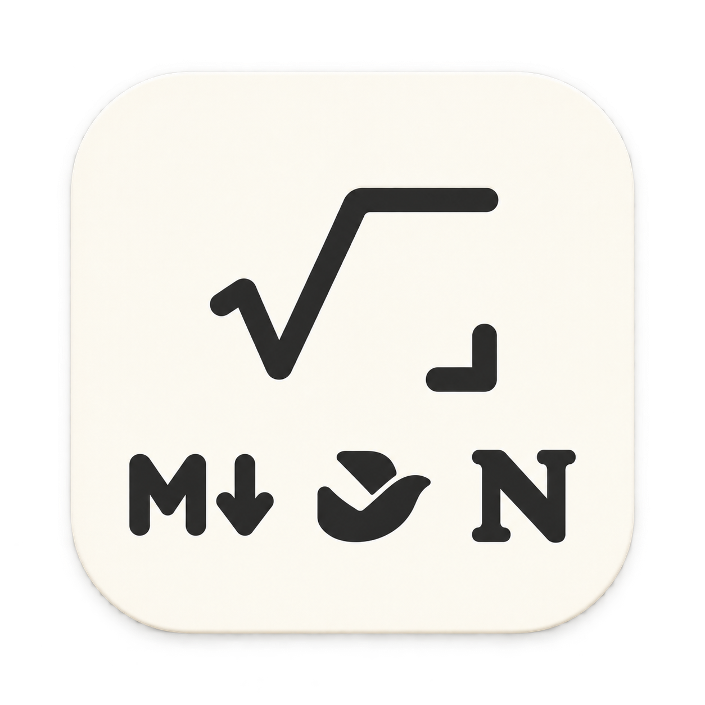

# MyMathpix



A personal-first native macOS snippet recognizer for formulas, tables, and mixed technical content. It captures a selected screen region, sends only that PNG to Datalab's hosted Convert API, and returns editable Markdown/LaTeX with an offline preview.

## Current scope

- Global `Control-Command-M` screen capture
- Datalab `fast` recognition and `balanced` high-quality retry
- Compact floating result after capture or a menu-bar click, with offline KaTeX preview and independent Original/Edit actions
- A separate large history/settings/usage workspace on Command-Tab, Dock/reopen or Open MyMathpix
- Whole-result Markdown / Lark / Notion copy actions; Lark and Notion include native editable equations and rich tables
- Local history containing the 20 most recent snippets
- API token stored in a private `0600` file inside the App Sandbox container

No account, subscription, backend, analytics, or cloud history is included in the Personal MVP.

Personal MVP V1 and the v0.1.1 Markdown / Lark / Notion paste update were accepted by the owner on 2026-10-22. Native clipboard compatibility depends on the destination version. Known open issue: editing in the middle of text may move the caret to the end. The fourteen-day Dogfood Gate remains pending. See the accepted contract and evidence limits in [the Personal MVP spec](.scratch/personal-mvp/spec.md).

## Download

[Download MyMathpix v0.1.2 for Apple Silicon](https://github.com/tterumiimurett/my_mathpix/releases/download/v0.1.2/MyMathpix-v0.1.2.zip). Requires macOS 15 or later.

1. Unzip the download and move `MyMathpix.app` to Applications.
2. Sign up or sign in on the [Datalab website](https://www.datalab.to/), then open the [API keys page](https://www.datalab.to/app/keys) to create and copy your own API key. MyMathpix requires this key to recognize Snippets.
3. Open MyMathpix → Settings → Datalab, paste the key into **API token**, then click **Test & Save**.
4. Allow Screen Recording when prompted, then use `Control-Command-M` to select a Snippet.

This personal MVP is ad-hoc signed and has not been notarized by Apple. If macOS blocks the first launch, use System Settings → Privacy & Security → Open Anyway after verifying the download source. Release assets include a SHA-256 checksum. This GitHub release does not complete the later Public Product or App Store release gates.

## Run

Double-click `启动 MyMathpix.command`, or run:

```sh
./scripts/build_app.sh
open ./dist/MyMathpix.app
```

The current machine needs Swift 6.2 or later. The first capture requires macOS Screen Recording permission. Enter a Datalab API token in Settings; it is stored in a private `0600` file inside the App Sandbox container and never written to preferences, history, or logs. MyMathpix does not read, migrate, write, or delete Keychain items.

The App icon source is `Config/AppIcon.png`. After changing it, run `./scripts/build_icon.sh` to regenerate the bundled `Config/AppIcon.icns`.

## Self-test

```sh
./scripts/test.sh
```

The current standalone Command Line Tools installation does not include XCTest, so this runs deterministic core checks through the app's `--self-test` entry point. Move them into XCTest after installing full Xcode.

## Third-party software

The offline formula preview bundles KaTeX under the MIT License. See `THIRD_PARTY_NOTICES.md`.
